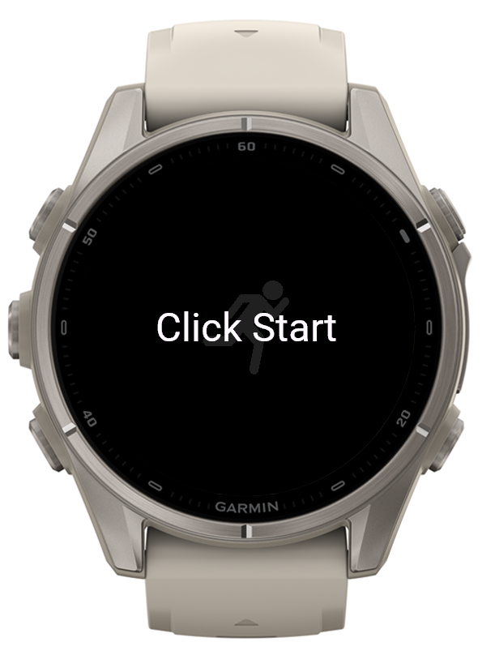
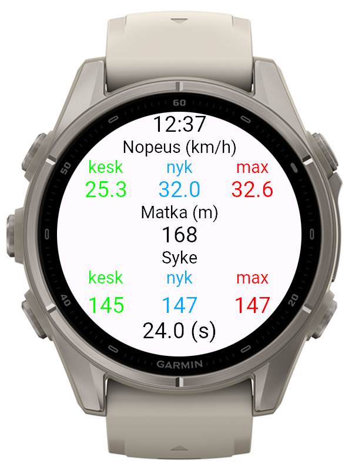
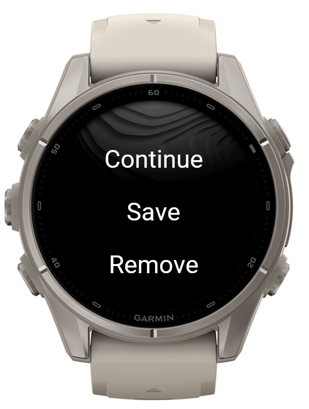

# Simple Run Tracker

A minimal running tracker for Garmin watches, built with Monkey C (Connect IQ).
A clean screen with everything you need during a run, and every activity is
saved to Garmin Connect as a normal FIT file.

## Screenshots

| Start | Tracking | Menu |
|:---:|:---:|:---:|
|  |  |  |

## Features

- Speed (km/h): average, current and maximum
- Distance (m)
- Heart rate: average, current and maximum
- Elapsed time, shown in the most suitable unit (s / min / h)
- Clock on top of the screen
- Records an activity (running) and saves it to Garmin Connect
- Languages: English, Finnish, Russian

## Usage

1. Open the app and press **Start**.
2. Press **Start/Stop** during the run to pause and open the menu:
   - **Continue**: resume the activity
   - **Save**: save the activity
   - **Remove**: discard the activity

## Tested devices

- Forerunner 945
- Fenix 9
- Instinct 3

## Build

Requirements: [Connect IQ SDK](https://developer.garmin.com/connect-iq/sdk/) and
VS Code with the Garmin Monkey C extension.

1. Clone the repository:
   ```
   git clone https://github.com/Cheer5ul/simple-run-tracker.git
   ```
2. Open the folder in VS Code.
3. Generate a developer key if you don't have one:
   `Monkey C: Generate a Developer Key` (keep it private, never commit it).
4. Run `Monkey C: Build Current Project` or press `F5` to try it in the simulator.

## Acknowledgements

Based on the example project
[SimpleRunTracker](https://github.com/easy-linux/Garmin/tree/main/Example1/SimpleRunTracker)
from the [Connect IQ tutorial series](https://www.youtube.com/watch?v=7TUgxddxx64&list=PLCh6bwt6jth-rd34jLy1lAQxKlWJ99n44)
by easy-linux. Extended with own features. 
